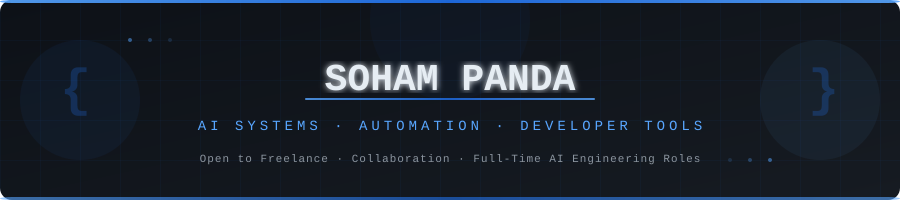
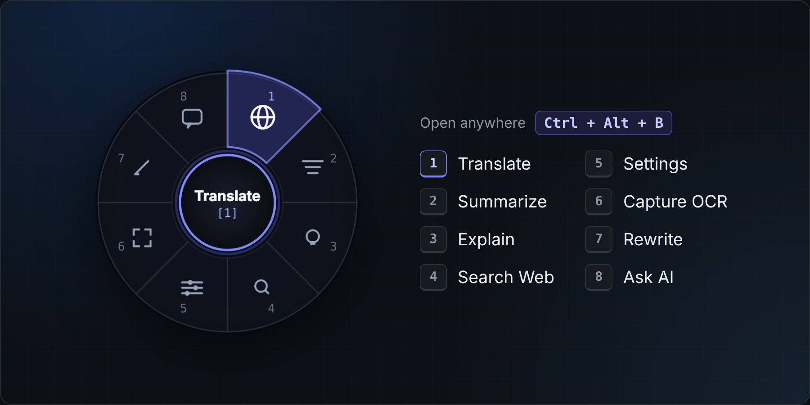
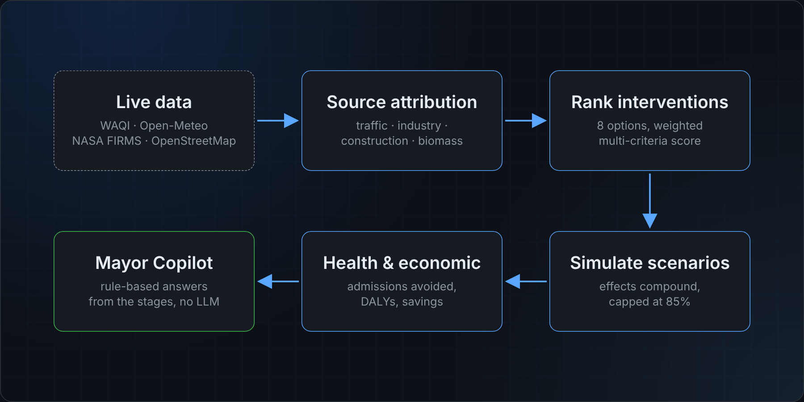
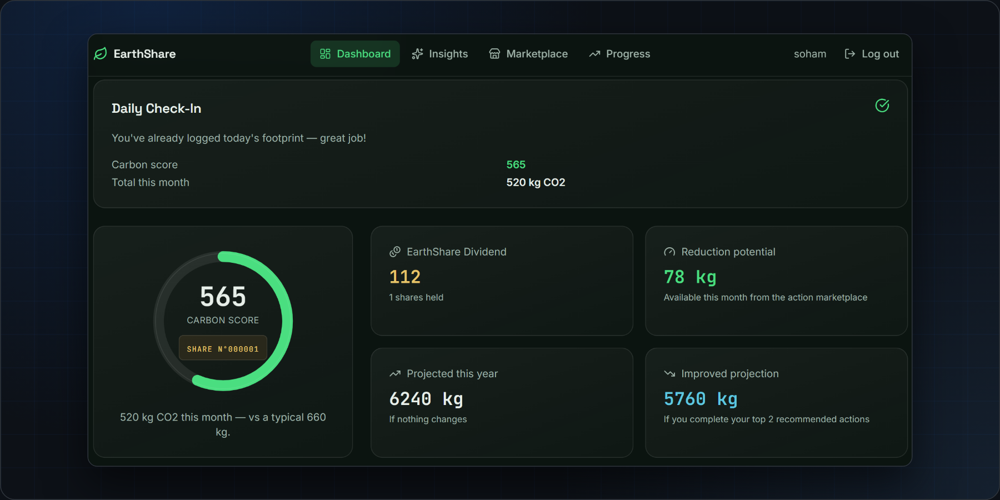

### Building AI tools that fit into the way people already work, and keep working when something goes wrong.

[How I build](#how-i-build) · [Toolbox](#toolbox) · [Evidence](#the-evidence) · [Where I'm heading](#where-im-heading)

 

I'm **Soham**. I build software that puts AI models inside real workflows rather than beside them. My work includes an assistant that appears at your cursor instead of in another browser tab, and a decision pipeline that shows its arithmetic instead of guessing. I've also fixed bugs inside open-source tools that developers use to build and run AI agents.

The model call is rarely the hard part. I'm most interested in everything around it: the integrations, the failure cases, the privacy boundaries, and the tests that turn an AI feature into something you can depend on.

## How I build

A few habits show up across everything I've made. Each links to where you can see it in code.

**🎯 Put the AI where the work already is.**
Every copy, tab switch and paste is friction. [Cursor Bite](https://github.com/Soham-o/cursor_bite) opens a menu at the mouse cursor through a global Windows hotkey. You act on selected text without leaving the window you're in.

**🔒 Keep data local unless there's a reason to send it.**
Cursor Bite translates, explains and OCRs with local engines (Ollama, Argos, Tesseract). Only web search goes online. A privacy gateway scans text before it does, and asks before anything sensitive leaves.

**🧮 Use models for language, and deterministic code for numbers.**
In [AirTwin X](https://github.com/Soham-o/AirTwin-X), the "copilot" answers only from values the pipeline has already computed, so every figure can be traced. [EarthShare](https://github.com/Soham-o/EarthShare) computes carbon estimates and insights with deterministic rules. Gemini can rephrase the insights, but it never does the accounting.

**🔌 Connect the whole system, then plan for the missing piece.**
AirTwin X joins four live data sources (air-quality sensors, weather, satellite fire data and road networks) into one pipeline. It keeps running when sources fail, because real APIs time out and keys go missing. Missing sensor data falls back to a simulation, and missing fire data to a weather-based estimate. Cursor Bite loads every engine lazily, so a bare install still starts.

**🧪 Keep going after the demo works.**
All three projects have test suites running in CI, about 300 tests in Cursor Bite alone. The same habit of reading code closely got two of my fixes merged into AI-agent tooling maintained by other people.

## Toolbox

**Used in working projects**

**AI & LLMs** · local models via Ollama · Gemini API · deterministic decision pipelines · XGBoost · scikit-learn 
**Automation & integrations** · REST APIs (WAQI, Open-Meteo, NASA FIRMS, OpenStreetMap, DuckDuckGo) · Windows global hotkeys and clipboard (pywin32) · OCR with Tesseract · GitHub Actions 
**Applications** · Python · PyQt6 desktop UI · Streamlit · FastAPI · Next.js / React · TypeScript 
**Engineering** · pytest · Vitest · ruff · Git · Linux

**Used lightly so far:** Rust (one merged fix) · PyTorch / Stable-Baselines3 (a PPO training script) · Docker (a container for a Streamlit app)

**Exploring next:** multi-agent frameworks such as CrewAI · voice agents · deploying Python services to Google Cloud

## The evidence

### ⌨️ [Cursor Bite](https://github.com/Soham-o/cursor_bite): AI at the cursor, on your own machine

**Problem:** using AI on a sentence in a PDF or an IDE means copying it into another app.
**Approach:** a native `RegisterHotKey` listener (no keyboard hooks) and a PyQt6 radial menu that opens instantly. Clipboard capture runs in parallel on a worker thread. The pipeline is split into `prepare()` and `execute()`, so a consent dialog can sit between them.
**What it shows:** desktop systems work, privacy-aware design and graceful degradation, backed by about 300 tests and Windows CI. *Working on Windows.*

### 🌫️ [AirTwin X](https://github.com/Soham-o/AirTwin-X): from "how bad is the air?" to "what should the city do?"

**Problem:** AQI dashboards report a number but don't help anyone decide what to do.
**Approach:** attribute pollution to its sources, rank eight interventions with a weighted score, and simulate combinations. Overlapping effects **compound** rather than add, and the total is capped at 85%. Health and cost estimates are derived from the result.
**What it shows:** integrating several live APIs, modelling with stated assumptions, and AI-style answers that stay auditable. *Prototype; 29 tests in GitHub Actions.*

### 🌍 [EarthShare](https://github.com/Soham-o/EarthShare): owning a carbon footprint, not just watching it

**Problem:** most carbon apps stop at charts and streaks.
**Approach:** a deterministic emissions engine behind a layered FastAPI backend (thin routes, services, repositories) with JWT auth, rate limiting and security headers, and a Next.js frontend.
**What it shows:** building a complete full-stack system with security and accessibility in mind. *Prototype built for a hackathon; CI runs the backend tests (85 passed, 1 skipped), the frontend tests (21 passed) and a production build.*

### 🔧 Fixes merged into open-source AI-agent tools

| Project | What I fixed |
|---|---|
| **[lintlang](https://github.com/hermes-labs-ai/lintlang)**, a linter that catches AI-agent config failures · [#88](https://github.com/hermes-labs-ai/lintlang/pull/88) ✅ | Non-string tool names in YAML configs crashed the parser with an internal `AttributeError`. Now they get a clear `tools[i].name must be a string` error and a regression test. |
| **[jcode](https://github.com/1jehuang/jcode)**, an AI coding-agent harness in Rust · [#1645](https://github.com/1jehuang/jcode/pull/1645) ✅ | An interrupted turn could leave an orphaned web-search block in saved history, and replaying it made the Anthropic API reject the whole request. The provider now drops those blocks before replay, with tests. |

<b>More of my work</b>

 

- **[PersonaLearn](https://github.com/Soham-o/PersonaLearn)**: a team project (5 people, 3-hour sprint) that uses Gemini to explain study topics through analogies from a learner's interests, then quizzes them.
- **ML notebooks**: [movie recommender](https://github.com/Soham-o/Movie_Recommender_System) (cosine similarity), [Spotify genre clustering](https://github.com/Soham-o/Spotify_Songs_Genre_Segmentation) (k-means) and [fake-news detection](https://github.com/Soham-o/Fake-News-Detection-) (TF-IDF and logistic regression).
- [All my public pull requests →](https://github.com/pulls?q=is%3Apr+author%3ASoham-o+is%3Apublic)

## Where I'm heading

Deeper into AI engineering, in three directions:
- **Agents** that take actions across tools rather than only answering questions.
- **Automation** that removes repetitive steps from everyday work.
- **Developer tools** that make AI systems easier to build, check and trust.

I'm studying computer science at SGT University alongside this work.

I'm open to open-source and research collaboration, freelance AI or automation projects, and full-time roles. If something here overlaps with what you're building, I'd like to hear about it.

